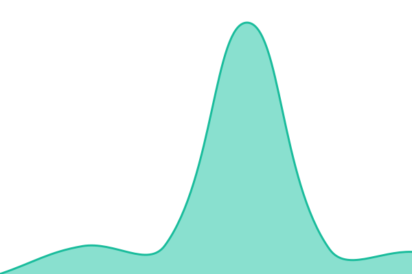
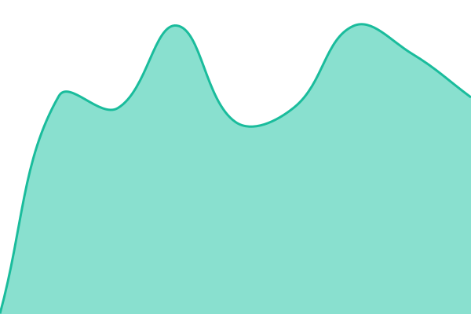
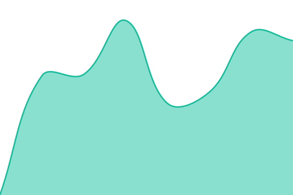
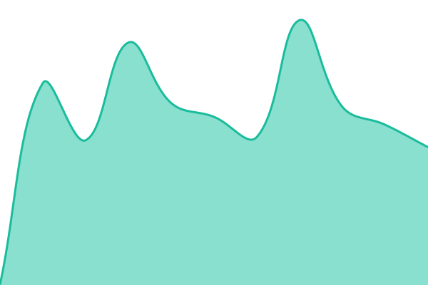
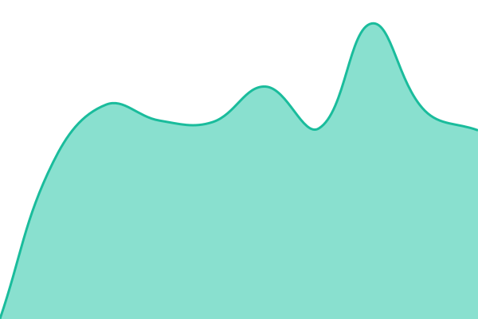

# [📈 Live Status](https://status.zebbox.net): <!--live status--> **🟧 Partial outage**

This repository contains the open-source uptime monitor and status page for [Sébastian Molle](https://status.zebbox.net), powered by [Upptime](https://github.com/upptime/upptime).

With [Upptime](https://upptime.js.org), you can get your own unlimited and free uptime monitor and status page, powered entirely by a GitHub repository. We use [Issues](https://github.com/zebby76/upptime/issues) as incident reports, [Actions](https://github.com/zebby76/upptime/actions) as uptime monitors, and [Pages](https://status.zebbox.net) for the status page.

<!--start: status pages-->
<!-- This summary is generated by Upptime (https://github.com/upptime/upptime) -->
<!-- Do not edit this manually, your changes will be overwritten -->
<!-- prettier-ignore -->
| URL | Status | History | Response Time | Uptime |
| --- | ------ | ------- | ------------- | ------ |
|  [www.zebbox.net](https://www.zebbox.net/) | 🟩 Up | [www.yml](https://github.com/zebby76/upptime/commits/HEAD/history/www.yml) | 

 590ms
     
 | 

<a href="https://status.zebbox.net/history/www">100.00%</a>
    

|  [oria — portail](https://oria.zebbox.net/) | 🟥 Down | [oria-portail.yml](https://github.com/zebby76/upptime/commits/HEAD/history/oria-portail.yml) | 

 1871ms
     
 | 

<a href="https://status.zebbox.net/history/oria-portail">74.69%</a>
    

|  [oria — monde 1](https://oria-w1.zebbox.net/) | 🟥 Down | [oria-monde-1.yml](https://github.com/zebby76/upptime/commits/HEAD/history/oria-monde-1.yml) | 

 623ms
     
 | 

<a href="https://status.zebbox.net/history/oria-monde-1">74.76%</a>
    

|  [oria — monde 2](https://oria-w2.zebbox.net/) | 🟥 Down | [oria-monde-2.yml](https://github.com/zebby76/upptime/commits/HEAD/history/oria-monde-2.yml) | 

 586ms
     
 | 

<a href="https://status.zebbox.net/history/oria-monde-2">74.84%</a>
    

|  [oria — monde 3](https://oria-w3.zebbox.net/) | 🟥 Down | [oria-monde-3.yml](https://github.com/zebby76/upptime/commits/HEAD/history/oria-monde-3.yml) | 

 437ms
     
 | 

<a href="https://status.zebbox.net/history/oria-monde-3">74.91%</a>
    

|  [stickers](https://stickers.zebbox.net/) | 🟩 Up | [stickers.yml](https://github.com/zebby76/upptime/commits/HEAD/history/stickers.yml) | 

 720ms
     
 | 

<a href="https://status.zebbox.net/history/stickers">100.00%</a>
    

|  [auth (Authelia)](https://auth.zebbox.net/) | 🟩 Up | [auth.yml](https://github.com/zebby76/upptime/commits/HEAD/history/auth.yml) | 

 529ms
     
 | 

<a href="https://status.zebbox.net/history/auth">100.00%</a>
    

|  [ntfy](https://ntfy.zebbox.net/) | 🟩 Up | [ntfy.yml](https://github.com/zebby76/upptime/commits/HEAD/history/ntfy.yml) | 

 567ms
     
 | 

<a href="https://status.zebbox.net/history/ntfy">100.00%</a>
    

|  [vault (Vaultwarden)](https://vault.zebbox.net/) | 🟩 Up | [vault.yml](https://github.com/zebby76/upptime/commits/HEAD/history/vault.yml) | 

 542ms
     
 | 

<a href="https://status.zebbox.net/history/vault">100.00%</a>
    

|  [gt7 (ingress + SSO)](https://gt7.zebbox.net/) | 🟩 Up | [gt7.yml](https://github.com/zebby76/upptime/commits/HEAD/history/gt7.yml) | 

 1100ms
     
 | 

<a href="https://status.zebbox.net/history/gt7">98.88%</a>
    

|  [chat (ingress + SSO)](https://chat.zebbox.net/) | 🟩 Up | [chat.yml](https://github.com/zebby76/upptime/commits/HEAD/history/chat.yml) | 

 939ms
     
 | 

<a href="https://status.zebbox.net/history/chat">98.93%</a>
    

|  [grafana (ingress + SSO)](https://grafana.zebbox.net/) | 🟩 Up | [grafana.yml](https://github.com/zebby76/upptime/commits/HEAD/history/grafana.yml) | 

 947ms
     
 | 

<a href="https://status.zebbox.net/history/grafana">98.97%</a>
    

|  [n8n (ingress + SSO)](https://n8n.zebbox.net/) | 🟩 Up | [n8n.yml](https://github.com/zebby76/upptime/commits/HEAD/history/n8n.yml) | 

 864ms
     
 | 

<a href="https://status.zebbox.net/history/n8n">99.02%</a>
    

|  [adguard (ingress + SSO)](https://adguard.zebbox.net/) | 🟩 Up | [adguard.yml](https://github.com/zebby76/upptime/commits/HEAD/history/adguard.yml) | 

 1050ms
     
 | 

<a href="https://status.zebbox.net/history/adguard">99.06%</a>
    

|  [whoami (ingress + SSO)](https://whoami.zebbox.net/) | 🟩 Up | [whoami.yml](https://github.com/zebby76/upptime/commits/HEAD/history/whoami.yml) | 

 841ms
     
 | 

<a href="https://status.zebbox.net/history/whoami">99.12%</a>
    

<!--end: status pages-->

[**Visit our status website →**](https://status.zebbox.net)

## 📄 License

- Powered by: [Upptime](https://github.com/upptime/upptime)
- Code: [MIT](./LICENSE) © [Anand Chowdhary](https://anandchowdhary.com)
- Data in the `./history` directory: [Open Database License](https://opendatacommons.org/licenses/odbl/1-0/)
